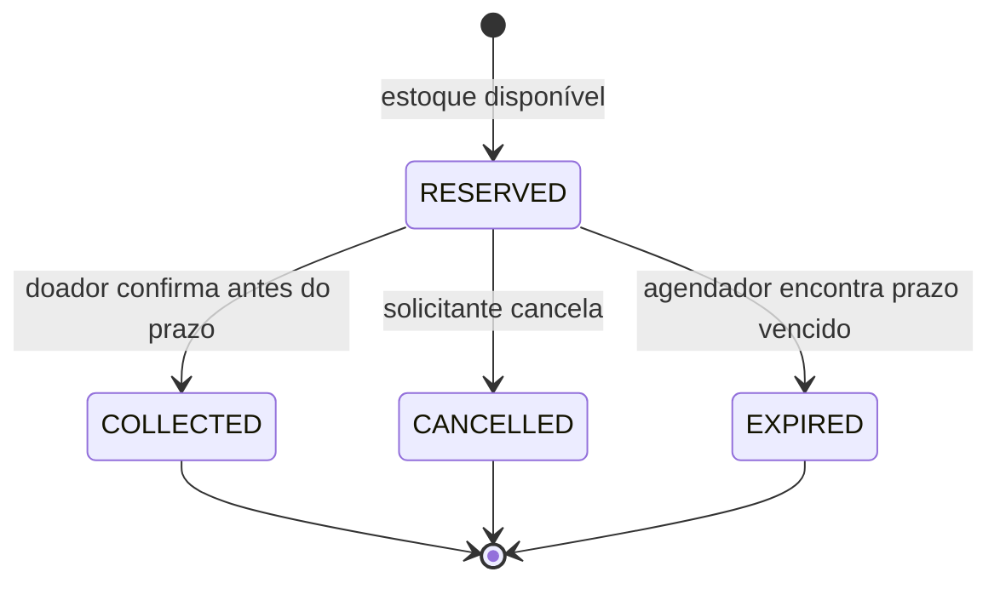

# ♻️ ReUse Hub

**Equipamentos circulando, oportunidades crescendo.**

API REST para organizar doações de equipamentos entre laboratórios, escolas, projetos
sociais e pessoas. Um doador anuncia um lote; outra pessoa reserva uma quantidade;
o doador confirma a retirada. Cancelamentos e expirações devolvem unidades ao estoque.

Um exemplo: um laboratório tem **cinco kits ESP32** parados. Um projeto educacional
reserva dois. A API mantém três disponíveis, impede uma segunda retirada das mesmas
unidades e registra o que aconteceu com cada reserva.

**Java 21 · Spring Boot 3.5.16 · PostgreSQL 17 · Maven Wrapper · MIT**

A aplicação oferece uma API REST e documentação interativa pelo Swagger UI. A retirada
física é combinada fora da plataforma. O fluxo atende laboratórios, escolas e grupos
que precisam organizar a disponibilidade e a entrega de equipamentos.

## Comece por aqui

- [Executar em poucos passos](#executar-em-poucos-passos)
- [Experimentar a API](#experimentar-a-api)
- [Regras de negócio](#regras-de-negócio)
- [Arquitetura e leitura do código](#arquitetura-e-leitura-do-código)
- [Concorrência e idempotência](#concorrência-e-idempotência)
- [Testes e evidências](#testes-e-evidências)
- [Usar como template](#usar-como-template)
- [Problemas comuns](#problemas-comuns)

## Por que este projeto?

O domínio aproxima desenvolvimento de software e reaproveitamento de hardware.
O problema é concreto e permite estudar regras de negócio que também aparecem em
bibliotecas, e-commerce, agendamento e gestão de estoque.

O código usa nomes em inglês e explicações em português. Classes explícitas,
injeção por construtor e poucos mecanismos implícitos ajudam na leitura. Maven
foi escolhido pelas convenções de projeto e pela execução reproduzível com o Wrapper.

## O que está implementado

| Área | Comportamento |
| --- | --- |
| Identidade | Cadastro, normalização de e-mail, BCrypt e login com JWT de curta duração |
| Catálogo | Criação, consulta pública, filtros, paginação e arquivamento pelo dono |
| Reservas | Quantidade, prazo, retirada, cancelamento e expiração automática |
| Estoque | Transação e bloqueio pessimista por oferta para evitar alocação duplicada |
| Repetição de pedidos | Chave de idempotência persistida e vinculada ao usuário |
| Histórico | Eventos de cada transição, na mesma transação da reserva |
| Permissões | Apenas participantes consultam reservas; somente o doador confirma retirada |
| Operação | Migrações Flyway, health checks, request ID, desligamento gracioso e Docker |
| Qualidade | JUnit, MockMvc, testes concorrentes, ArchUnit, JaCoCo e CI |

Não há pagamento, frete, chat, geolocalização, validação de organizações, recuperação
de senha ou administração global. Não há cálculo de CO₂ evitado: uma retirada
registrada não fornece dados suficientes para estimar esse impacto.

## Executar em poucos passos

**Requisitos:** Docker Engine/Desktop com Compose v2 e Python 3.10+.
O caminho completo com Docker não exige Java nem Maven instalados no computador.
A primeira execução baixa dependências e imagens, portanto precisa de internet.

Com o código obtido e o Docker em execução, abra um terminal na pasta `reuse-hub`:

```bash
python scripts/setup_env.py
docker compose up --build -d
```

No Windows, use `py` no lugar de `python` se esse for o comando disponível.
O script de configuração cria `.env` com senha de banco e chave JWT aleatórias.
Se já existir, ele preserva os valores. O arquivo é ignorado pelo Git.

Aguarde a aplicação iniciar. Para acompanhar:

```bash
docker compose logs -f app
```

Quando aparecer `Started ReuseHubApplication`, abra o Swagger. Use `Ctrl+C` para
sair dos logs; os contêineres continuam funcionando.

O preenchimento com dados fictícios é opcional:

```bash
python scripts/demo.py
```

Esse script testa o fluxo da API; ele não inicia o servidor.

| Endereço | Finalidade |
| --- | --- |
| <http://localhost:8080/swagger-ui.html> | Explorar os contratos e executar chamadas |
| <http://localhost:8080/v3/api-docs> | Documento OpenAPI gerado pela aplicação |
| <http://localhost:8080/actuator/health> | Saúde da API e acesso ao banco |
| <http://localhost:8080/api/v1/offers> | Catálogo público em JSON |

A raiz `/` não é uma página inicial. Use um dos endereços acima.
O Compose publica as portas apenas em `127.0.0.1`, adequado à demonstração local.
O banco usa volume persistente: reiniciar a aplicação não apaga os registros.

### Iniciar e parar no dia a dia

Com o Docker em execução, use os comandos abaixo dentro da pasta do projeto:

```bash
# Iniciar novamente
docker compose up -d

# Parar sem remover os contêineres nem o volume do banco
docker compose stop
```

Não é necessário clonar o projeto, recriar `.env` ou executar a demonstração a cada
inicialização. Fechar o terminal ou a aba do navegador não encerra os contêineres.
Após alterar código Java, dependências ou Dockerfile, reconstrua a imagem com
`docker compose up --build -d`.

`docker compose down` remove os contêineres e a rede, mas mantém os dados. **`docker compose down -v` apaga o volume e todos os dados
locais**; use apenas quando quiser realmente reiniciar a demonstração do zero.

### Executar o Java pela IDE ou pelo terminal

Instale um **JDK 21**, configure `JAVA_HOME` e confirme com `java -version` e
`javac -version`. O Maven Wrapper dispensa uma instalação separada do Maven.

Neste modo, somente o banco roda em Docker. A aplicação Java precisa acessar uma
porta do banco publicada no computador. Se o serviço `db` estiver sem `ports`,
adicione esse bloco **dentro de `db`** no `compose.yml`. Se já existir, ajuste o
mapeamento em vez de criar um segundo bloco:

```yaml
ports:
  - "127.0.0.1:5433:5432"
```

Neste exemplo, `5433` é a porta do computador e `5432` continua sendo a porta interna
do PostgreSQL. Use outra porta do computador caso `5433` esteja indisponível.

Execute `python scripts/setup_env.py` se ainda não houver `.env`. Depois, acrescente
ou ajuste a URL no `.env`:

```dotenv
DB_URL=jdbc:postgresql://localhost:5433/reusehub
```

Se o contêiner da aplicação estiver rodando, pare-o para liberar a porta 8080.
Então inicie o banco e execute o Java:

```bash
docker compose stop app
docker compose up -d db
python scripts/run_local.py
```

O script carrega `.env` e executa `mvnw spring-boot:run`, ou `mvnw.cmd` no Windows.
Variáveis já presentes no ambiente têm precedência. O Spring Boot não lê arquivos
`.env` automaticamente; o Compose e esse script fazem essa parte.

Na IDE, importe `pom.xml`, selecione JDK 21 e execute `ReuseHubApplication` com
`DB_URL`, `DB_PASSWORD` e `JWT_SECRET` configurados no ambiente. O banco precisa
estar disponível antes de iniciar a aplicação. Ao terminar uma execução pelo
terminal, use `Ctrl+C` para encerrar o Java.

Quando a aplicação também roda no Docker, o Compose usa explicitamente
`jdbc:postgresql://db:5432/reusehub`. A porta publicada no computador não altera
esse endereço interno.

### Configuração

| Variável/propriedade | Padrão | Explicação |
| --- | --- | --- |
| `DB_URL` | `jdbc:postgresql://localhost:5432/reusehub` | Endereço JDBC; no Compose aponta para `db` |
| `DB_USER` | `reusehub` | Usuário do banco |
| `DB_PASSWORD` | Obrigatória | Sem senha de aplicação embutida no código |
| `JWT_SECRET` | Obrigatória | Ao menos 32 bytes aleatórios codificados em Base64 |
| `SPRING_PROFILES_ACTIVE` | `default` | `prod` desativa Swagger e OpenAPI |
| `APP_SECURITY_TOKEN_TTL` | `15m` | Expiração do JWT; máximo de uma hora |
| `APP_RESERVATION_TTL` | `24h` | Prazo de uma nova reserva |
| `APP_RESERVATION_EXPIRATION_DELAY_MS` | `60000` | Intervalo entre lotes de expiração |
| `APP_RESERVATION_SCHEDULING_ENABLED` | `true` | Permite desativar o agendador |

Os nomes `APP_*` seguem o relaxed binding do Spring para as propriedades de
`application.yml`. Se quiser passá-los ao contêiner, adicione-os ao bloco
`environment` de `app` no Compose; variáveis do host não entram nele automaticamente.

O perfil `test` vive em `src/test/resources` e utiliza uma chave conhecida apenas
para testes. O H2 também é dependência exclusiva de teste. Nenhum deles é incluído
como modo de demonstração inseguro no JAR de produção.

## Experimentar a API

### Demonstração automática

```bash
python scripts/demo.py
```

O script espera a aplicação responder, cria duas contas fictícias e executa:

1. Cadastro e login do laboratório e do projeto educacional.
2. Publicação de dois kits ESP32.
3. Reserva de um kit e repetição da chamada com a mesma chave.
4. Tentativa de retirada por quem não tem permissão: resposta `403`.
5. Retirada confirmada pelo doador.
6. Segunda reserva, cancelamento e repetição do cancelamento.
7. Conferência do histórico e do estoque final: uma unidade disponível.

Cada execução cria novos registros com e-mails em `example.test`. O script não
apaga esses dados nem mostra tokens e senhas. Ele modifica a API indicada; use
`--base-url URL_DA_INSTANCIA` para apontar a outra instância de testes.

### Pelo Swagger UI

1. Execute `POST /api/v1/auth/register` com nome, e-mail e senha de 12 a 72 caracteres.
   Por causa do BCrypt, o limite adicional é de **72 bytes UTF-8**, relevante para acentos.
2. Execute `POST /api/v1/auth/login` com o e-mail e a senha.
3. Copie `accessToken`, clique em **Authorize** e cole apenas o token.
4. Crie uma oferta com a conta doadora e guarde o `id` retornado.
5. Cadastre uma segunda conta, faça login e substitua o token em **Authorize**.
   O login sozinho não troca a autorização ativa do Swagger. Confira a identidade
   atual em `GET /api/v1/auth/me`.
6. Crie uma reserva com o ID da oferta e uma quantidade disponível. Em
   `Idempotency-Key`, informe um UUID novo e guarde o ID da reserva retornada.
7. Repita a mesma chamada com a mesma chave: a resposta deve ser `200`, com o mesmo
   ID de reserva e sem nova redução do estoque. A primeira chamada retorna `201`.
8. Para confirmar a retirada, volte ao token do doador e use
   `POST /api/v1/reservations/{id}/collect`. Para cancelar, use o token do solicitante
   em `POST /api/v1/reservations/{id}/cancel` antes de finalizar a reserva.

Uma reserva retirada não pode ser cancelada. Para testar os dois caminhos, crie
reservas distintas com chaves diferentes. O ID da reserva e o ID da oferta não são
intercambiáveis. Ao receber `401`, faça login novamente e atualize a autorização.

Com uma oferta inicial de cinco unidades, os resultados esperados são:

| Ação | Estoque disponível | Resultado |
| --- | --- | --- |
| Reservar duas unidades | 3 | `201`, estado `RESERVED` |
| Repetir o mesmo pedido e chave | 3 | `200`, mesma reserva |
| Confirmar retirada como solicitante | 3 | `403` |
| Confirmar retirada como doador | 3 | `200`, estado `COLLECTED` |
| Criar outra reserva de uma unidade | 2 | `201`, nova reserva |
| Cancelar a nova reserva como solicitante | 3 | `200`, estado `CANCELLED` |
| Repetir esse cancelamento | 3 | `200`, sem reposição adicional |

Exemplo de oferta:

```json
{
  "title": "Kit ESP32 + sensores",
  "description": "Kit funcional para aulas de robótica. Retirada a combinar.",
  "category": "ELECTRONICS",
  "condition": "GOOD",
  "city": "Rio de Janeiro",
  "quantity": 5
}
```

As categorias são `COMPUTERS`, `ELECTRONICS`, `TOOLS`, `EDUCATION` e `OTHER`.
As condições são `NEW`, `GOOD` e `NEEDS_REPAIR`.

Exemplo de reserva, substituindo o UUID pelo `id` da oferta criada:

```http
POST /api/v1/reservations
Authorization: Bearer SEU_TOKEN
Idempotency-Key: 16a77021-b2ca-42a5-99ae-de0f726e458f
Content-Type: application/json

{"offerId":"UUID_DA_OFERTA","quantity":2}
```

Há uma coleção com chamadas encadeadas em [http/reuse-hub.http](http/reuse-hub.http),
para a extensão REST Client do VS Code. Ela usa contas fictícias com nomes fixos:
na segunda execução, o cadastro retorna `409`; o login continua funcionando.

### Rotas

O prefixo é `/api/v1`. Não se envia `ownerId` ou `requesterId` na criação: a API
obtém o usuário a partir do JWT validado.

| Método e rota | Acesso | Resultado |
| --- | --- | --- |
| `POST /auth/register` | Público | `201`, conta sem hash de senha |
| `POST /auth/login` | Público | `200`, token Bearer e validade em segundos |
| `GET /auth/me` | Autenticado | Dados da própria conta |
| `GET /offers` | Público | Página de ofertas ativas |
| `GET /offers/{id}` | Público | Uma oferta, inclusive se arquivada |
| `POST /offers` | Autenticado | `201` e cabeçalho `Location` |
| `POST /offers/{id}/archive` | Dono da oferta | Arquiva; repetir é seguro |
| `POST /reservations` | Autenticado | `201`, ou `200` em replay |
| `GET /reservations` | Autenticado | Reservas em que o usuário é participante |
| `GET /reservations/{id}` | Participante | Detalhe da reserva |
| `GET /reservations/{id}/events` | Participante | Histórico de estados |
| `POST /reservations/{id}/cancel` | Solicitante | Cancela e devolve estoque |
| `POST /reservations/{id}/collect` | Doador | Confirma retirada sem devolver estoque |

Catálogo: `category`, `city`, `search`, `availableOnly`, `page` e `size`.
A cidade usa igualdade sem distinguir maiúsculas; a busca procura no título,
sem remover acentos. `%` e `_` são caracteres literais, não curingas fornecidos
pelo cliente. `availableOnly=true` omite estoque zero por padrão.

Reservas: `status`, `page` e `size`. Nas duas listagens, a página começa em zero,
o tamanho padrão é 20 e o máximo é 100. A ordenação é `createdAt DESC, id DESC`.
O limite de página é 10.000; catálogos grandes devem evoluir para paginação por cursor.

```json
{"content": [], "page": 0, "size": 20, "totalElements": 0, "totalPages": 0}
```

### Erros previsíveis

A API usa `application/problem+json`, com um `code` estável para o cliente e um
`requestId` também presente no cabeçalho `X-Request-Id`.

```json
{
  "type": "urn:reuse-hub:problem:insufficient_stock",
  "title": "Conflict",
  "status": 409,
  "detail": "Quantidade indisponível.",
  "instance": "/api/v1/reservations",
  "code": "INSUFFICIENT_STOCK",
  "requestId": "IDENTIFICADOR_DA_REQUISICAO"
}
```

| HTTP | Exemplos |
| --- | --- |
| `400` | Campos inválidos, UUID malformado, chave ausente ou JSON desconhecido |
| `401` | Credencial incorreta, token inválido ou autenticação ausente |
| `403` | Participante sem permissão para aquela ação |
| `404` | Recurso inexistente ou reserva de terceiros |
| `405` | Método HTTP incompatível com a rota |
| `409` | Estoque insuficiente, estado final, e-mail duplicado ou chave reutilizada |
| `415` | Tipo de conteúdo incompatível com a rota |
| `500` | Falha inesperada; detalhes internos não são enviados ao cliente |

## Regras de negócio



- O lote contém de 1 a 10.000 unidades. Sua quantidade inicial é imutável.
- Uma conta pode ser doadora e solicitante, mas não reservar a própria oferta.
- Criar reserva subtrai estoque imediatamente. Cada reserva pertence a uma oferta.
- Retirada é irreversível nesta versão. Uma eventual devolução precisa de um novo caso de uso.
- Cancelar ou expirar libera unidades exatamente uma vez por transição confirmada.
- Repetir a mesma retirada ou o mesmo cancelamento retorna o estado existente.
- Trocar um estado final por outro retorna `409`.
- Arquivar impede novas reservas e tira a oferta da listagem. Não apaga histórico,
  não cancela reservas existentes e não impede sua retirada ou cancelamento.
- O histórico registra ator, instante e sequência: `0` para criação e `1` para
  finalização. Assim, instantes iguais não invertem a ordem. Expiração tem `actorId=null`.
- O catálogo não expõe e-mail nem senha. Uma reserva não fica pública por conhecer seu UUID.

O agendador busca até 100 reservas por ciclo. Cada item tem sua própria transação;
uma falha não desfaz os outros. O prazo bloqueia a retirada imediatamente, mas o
estoque é liberado quando o agendador processa a expiração. Portanto, após o prazo,
pode existir um pequeno atraso na disponibilidade. Com fila grande ou indisponibilidade,
o atraso pode ultrapassar um minuto.

Enquanto uma reserva ainda estiver em `RESERVED`, o solicitante pode cancelá-la,
mesmo após o prazo. Se o agendador chegar primeiro, ela será `EXPIRED` e o
cancelamento retornará `409`. Ambos os caminhos preservam o estoque.

## Arquitetura e leitura do código

É um **monólito modular por funcionalidade**: uma aplicação, um banco e um artefato
de implantação. Os módulos são pacotes Java, não serviços separados nem subprojetos Maven.
Os testes ArchUnit verificam dependências e ausência de ciclos.

| Caminho dentro de `src/main/java/io/github/mmlegend/reusehub` | Papel |
| --- | --- |
| `identity` | Contas, autenticação e emissão de tokens |
| `offers` | Catálogo e regras de estoque |
| `reservations` | Ciclo da reserva, histórico e expiração |
| `shared` | Erros, paginação e configuração transversal |
| `*/api` | Controllers, entrada HTTP, validação e DTOs de requisição |
| `*/application` | Casos de uso, transações e DTOs de resposta |
| `*/domain` | Estado e regras das entidades |
| `*/persistence` | Repositórios Spring Data JPA |

A separação é pragmática: as entidades de domínio têm anotações JPA e os serviços
usam repositórios Spring Data. **Não é uma implementação estrita de Clean Architecture.**
Se o projeto crescer e precisar de domínio independente de ORM, extraia portas e
adaptadores com mapeamento explícito. Fazer isso agora duplicaria modelos sem uma
necessidade concreta.

O módulo de reservas acessa identidade por `AccountAccess` e estoque por
`OfferInventory`, contratos da camada de aplicação. Não importa os repositórios
nem as entidades desses módulos. `Propagation.MANDATORY` exige que essas operações
participem da transação já iniciada pelo caso de uso.

### Caminho de uma requisição

1. `SecurityConfig` valida assinatura, expiração, emissor, audiência e UUID do JWT.
2. `ReservationController` valida JSON/cabeçalho e extrai o ator do token.
3. `ReservationService` abre a transação e coordena identidade, estoque e reserva.
4. `Offer` e `Reservation` aplicam suas regras sem conhecer HTTP.
5. Os repositórios persistem entidades e evento. O commit acontece antes da resposta.
6. O controller devolve um DTO; entidades JPA e hashes de senha não são serializados.

Comece lendo `Offer.reserve`, depois `Reservation.cancel`, `ReservationService.create`
e, por último, `ApiIntegrationTest`. É uma boa sequência para ligar regra, persistência
e comportamento observável.

### Persistência

| Tabela | Dados principais |
| --- | --- |
| `accounts` | Nome, e-mail normalizado, hash BCrypt e criação |
| `offers` | Doador, categoria, condição, cidade e estoque |
| `reservations` | Participantes, quantidade, chave, estado e prazo |
| `reservation_events` | Transições confirmadas e seus atores |

As migrations ficam em `src/main/resources/db/migration`. Flyway controla a ordem e
o checksum dos arquivos. Depois de aplicada uma migration em ambiente compartilhado,
crie outra para alterar o schema; não reescreva a antiga. O Hibernate usa
`ddl-auto=validate`, portanto não cria nem altera tabelas silenciosamente.

As referências usam UUIDs e chaves estrangeiras. Índices apoiam consultas de catálogo,
participantes e vencimentos. Constraints garantem limites de estoque, unicidade de
e-mail e da chave de idempotência. `@Version` adiciona detecção de atualização obsoleta.
O fuso usado para persistência é UTC; a interface consumidora converte a apresentação.

## Concorrência e idempotência

### Disputa pela última unidade

Ler `available=1` e depois subtrair sem coordenação permitiria que duas pessoas
recebessem confirmação. Por isso, a API utiliza `PESSIMISTIC_WRITE` na oferta.
A segunda transação aguarda a primeira e verifica o estoque já atualizado.
Se acabou, recebe `409 INSUFFICIENT_STOCK`.

O PostgreSQL tem `lock_timeout=5s` nas conexões da aplicação. O limite se aplica à espera
por bloqueios, não à duração total da requisição; uma falha de concorrência pode resultar em `409 CONCURRENT_OPERATION`.
A transação inclui estoque, reserva e evento: falhar ao salvar o histórico também
reverte a alteração de estoque.

### Pedido repetido

Uma queda de conexão pode fazer o cliente não saber se a reserva foi criada.
Em vez de gerar outra chave, ele repete a mesma requisição com o mesmo UUID.

| Situação | Resposta |
| --- | --- |
| Chave nova para aquela conta | `201` e `Idempotency-Replayed: false` |
| Mesma chave, oferta e quantidade | `200`, mesma reserva e `Idempotency-Replayed: true` |
| Mesma chave, conteúdo diferente | `409 IDEMPOTENCY_KEY_REUSED` |
| Mesma chave em outra conta | Pedido independente |

O replay retorna o **estado atual** da reserva, não uma cópia congelada da resposta
original. Uma reserva cancelada continua cancelada no replay. Para uma nova intenção,
o cliente usa outra chave. A chave dura enquanto o registro existir; não há limpeza
ou janela de expiração de idempotência nesta versão.

A criação bloqueia primeiro a conta solicitante e depois a oferta. Isso serializa
pedidos simultâneos da mesma conta, inclusive se uma chave for usada em duas ofertas.
A constraint única é uma proteção adicional. Esse desenho privilegia clareza e
consistência; uma conta com alto volume pode precisar de uma tabela específica de
idempotência no futuro.

Nas transições, a ordem é **oferta → reserva**. Uma projeção com IDs é lida primeiro;
a entidade mutável da reserva só é carregada depois do lock, evitando um estado
antigo no cache de primeiro nível do JPA. O agendador usa a mesma ordem. Instâncias
simultâneas podem selecionar o mesmo vencimento, mas apenas uma confirma a transição.

## Segurança e operação

- BCrypt com custo 12; senhas não são salvas em texto simples.
- JWT HS256 validado pelo Resource Server do Spring Security, sem filtro JWT artesanal.
- O emissor e a API compartilham a chave neste monólito. Serviços separados podem
  evoluir para um provedor OIDC e chaves assimétricas.
- Sem sessões de servidor ou cookies de autenticação. CSRF está desativado para o
  contrato Bearer; ao introduzir autenticação por cookie, essa decisão deve ser revista.
- Não há CORS permissivo. Um frontend em outra origem exige configuração explícita.
- Tokens expiram em 15 minutos. Não há refresh token ou revogação individual;
  sair do cliente remove a cópia local, mas não invalida um token ainda válido.
- O cadastro informa e-mail duplicado. Para um serviço público sensível, avalie um
  fluxo com verificação de e-mail e respostas que reduzam enumeração de contas.
- Logs não registram corpo, senha ou token. O request ID ajuda a localizar falhas.
- O contêiner executa com usuário não root. O Compose restringe escrita e capabilities.

Para disponibilizar na internet, configure HTTPS em proxy/ingress, proteção contra
abuso e limitação de requisições, política de retenção de dados, backups com teste
de restauração e monitoramento. Verifique as atualizações de dependências e execute
a CI.

As versões das dependências estão definidas no `pom.xml`. Mudanças de versão devem
ser acompanhadas pela leitura das notas de compatibilidade e pela execução da suíte.
O Dependabot está configurado para propor atualizações de Maven, Docker e GitHub Actions.

## Testes e evidências

Os testes locais não exigem Docker ou PostgreSQL: usam H2 em modo de compatibilidade,
com as mesmas migrations e a aplicação Spring real. JDK 21 é necessário.

```bash
./mvnw verify
```

No PowerShell:

```powershell
.\mvnw.cmd verify
```

| Grupo | O que verifica |
| --- | --- |
| `OfferTest` | Limites, insuficiência, reposição e arquivamento |
| `ReservationTest` | Permissões, estados finais, prazo e repetição de ações |
| `ArchitectureTest` | Camadas, módulos sem ciclos e acesso apenas por contratos |
| `ApiIntegrationTest` | HTTP, JWT real, Flyway/JPA, rollback, isolamento e concorrência |

Os testes concorrentes usam threads e transações distintas, sincronizadas por
latches, sem `sleep` para tentar provocar a corrida. Há cenários de última unidade,
mesma chave, chave em ofertas diferentes, cancelamentos simultâneos, disputa entre
retirada e cancelamento e expiração repetida.

O Mockito é carregado por `-javaagent` na inicialização dos testes; o JaCoCo mantém
seu próprio agente. Isso evita depender de autoanexação dinâmica na JVM.
O relatório de cobertura fica em `target/site/jacoco/index.html`. Cobertura é evidência
complementar; o build não impõe uma porcentagem arbitrária como prova de qualidade.

**H2 não substitui PostgreSQL.** O workflow em `.github/workflows/ci.yml` está
configurado para executar a mesma suíte com H2 e PostgreSQL 17, construir a imagem
Docker e rodar a demonstração via HTTP no contêiner. Ele é acionado em pushes para
`main`, pull requests ou manualmente na aba Actions, quando habilitado no repositório.
Consulte os resultados da execução correspondente à versão que pretende utilizar.

Para rodar a suíte contra um PostgreSQL local, use um **banco exclusivo de teste**.
Os testes apagam os registros das quatro tabelas a cada caso. Nunca aponte estas
variáveis para um banco com dados que queira preservar.

```bash
# Depois de criar reusehub_test com um usuário autorizado:
TEST_DB_URL=jdbc:postgresql://localhost:5432/reusehub_test \
TEST_DB_USER=reusehub TEST_DB_PASSWORD=SENHA_DO_BANCO \
TEST_DB_INIT_SQL="SET lock_timeout TO '5s'" ./mvnw verify
```

No PowerShell, atribua as mesmas variáveis por `$env:TEST_DB_URL = '...'` e execute
`.\mvnw.cmd verify`. O workflow contém um exemplo completo de banco de testes isolado.

## Usar como template

A estrutura pode ser adaptada para outros back-ends Spring Boot:

1. Crie um novo repositório a partir da base e renomeie o projeto e o pacote Java
   usando a refatoração da IDE.
2. Atualize `groupId`, `artifactId`, nome da aplicação, nome do JAR no Dockerfile,
   banco, OpenAPI, testes e CI.
3. Mantenha a configuração externa, o tratamento de erros e a infraestrutura que
   fizerem sentido para o novo domínio.
4. Substitua ofertas e reservas por módulos com casos de uso próprios. Defina
   permissões e invariantes antes de copiar mecanismos de lock ou idempotência.
5. Em um banco novo, crie suas migrations iniciais. Em um banco já utilizado,
   preserve as migrations aplicadas e acrescente novas versões.
6. Gere novos segredos, escreva os testes das novas regras e atualize a documentação.

Um sistema de agendamento, por exemplo, precisa modelar capacidade por horário;
um CRM pode precisar de isolamento por organização. Essas regras exigem modelagem
própria, além da troca de nomes de classes.

## Problemas comuns

| Sintoma | Causa provável / ação |
| --- | --- |
| `JWT_SECRET` ou `DB_PASSWORD` ausente | Gere `.env` e use Compose ou `run_local.py` |
| Erro de Base64 ou tamanho de chave | Gere novamente uma chave aleatória de 32 bytes; não use uma frase |
| Banco recusa senha depois de mudar `.env` | O volume existente mantém a senha antiga; altere-a no banco, ou recrie apenas dados descartáveis |
| `Connection refused` | Confirme `docker compose ps` e endereço/porta do banco |
| Porta 8080 indisponível | Pare a outra execução da aplicação ou altere a porta publicada de `app` e a URL de acesso |
| Porta 5432 ocupada ou reservada no Windows | Na execução completa em Docker, remova apenas `ports` do serviço `db`; para executar Java pela IDE, publique uma porta disponível e ajuste `DB_URL` |
| `401` depois de algum tempo | Token expirou; execute login novamente |
| `409` ao reservar | Veja `code`: falta de estoque, chave reutilizada ou estado inválido |
| Swagger não abre em `prod` | Documentação é desativada nesse perfil; use `default` no ambiente de estudo |
| `release version 21 not supported` | Maven está usando outro Java; confira `JAVA_HOME` e `./mvnw -version` |
| `Permission denied` em `mvnw` após extrair ZIP | No Linux/macOS, execute `chmod +x mvnw`; o clone Git preserva esse atributo |
| CI de PostgreSQL falha | Leia os relatórios; não considere o teste em H2 suficiente para liberar a mudança |

### Conflito na porta do PostgreSQL

Na execução completa em Docker, aplicação e banco se comunicam por `db:5432`.
Se o Windows impedir a publicação da porta 5432, remova somente este bloco do
serviço `db` em `compose.yml`:

```yaml
ports:
  - "127.0.0.1:5432:5432"
```

Mantenha a publicação da porta 8080 do serviço `app` e execute `docker compose up -d`.
Essa alteração não exige reconstruir a imagem nem apagar o volume do banco.
A execução pela IDE exige uma porta publicada, conforme a seção específica acima.

## Referências e próximos passos

Documentação oficial: [Spring Boot 3.5](https://docs.spring.io/spring-boot/3.5/),
[Spring Security JWT](https://docs.spring.io/spring-security/reference/servlet/oauth2/resource-server/jwt.html),
[Spring Data JPA](https://docs.spring.io/spring-data/jpa/reference/),
[springdoc](https://springdoc.org/) e [PostgreSQL](https://www.postgresql.org/docs/17/).

Evoluções possíveis: verificação de e-mail, moderação, coordenação da retirada,
fotos com armazenamento externo, paginação por cursor, métricas de itens efetivamente
retirados e outbox para notificações confiáveis. Cada item deve vir com uma necessidade
concreta e testes; não é necessário transformá-los em microserviços.

Licenciado sob [MIT](LICENSE).
